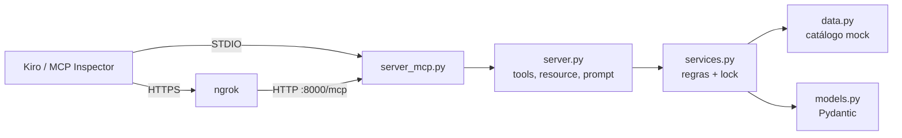

# Guia 1: Criando o servidor MCP "Vestuário MCP" do zero

Este guia mostra, passo a passo, como criar um servidor MCP em Python que simula o backend de uma loja de roupas. O código completo de cada arquivo está no repositório; aqui ficam os trechos mais importantes, com a explicação de cada decisão.

---

## 0. Conceitos

**MCP (Model Context Protocol)** é um protocolo aberto que padroniza como uma aplicação de IA (o *cliente*, por exemplo o Kiro) conversa com sistemas externos (os *servidores*). Pense nele como um "USB-C para IA": um servidor escrito uma vez funciona em qualquer cliente compatível.

Um servidor MCP expõe três tipos de capacidade:

| Primitiva | Quem decide usar | Exemplo neste projeto |
|---|---|---|
| **Tool** | O modelo (LLM) | `adicionar_ao_carrinho`: executa uma ação |
| **Resource** | A aplicação ou o usuário | `ecommerce://politica-trocas`: dado somente leitura |
| **Prompt** | O usuário | `recomendar_look`: um template de instrução pronto |

E dois transportes principais:

- **STDIO**: o cliente inicia o servidor como subprocesso e conversa por stdin/stdout. É o modo local.
- **Streamable HTTP**: o servidor escuta numa porta (`/mcp`). É o modo remoto, que o [Guia 2](02-expondo-com-ngrok.md) expõe com ngrok.

As mensagens são JSON-RPC 2.0 nos dois casos.



> **Nota:** no SDK v2, o `FastMCP` dos tutoriais antigos agora se chama `MCPServer`. O import `from mcp.server.fastmcp import FastMCP` dá `ModuleNotFoundError` na versão 2.x.

---

## 1. Preparando o ambiente

### 1.1 Pré-requisitos

```bash
python3 --version   # 3.11 ou mais novo (o SDK v2 exige)
node --version      # 18+; o MCP Inspector roda via npx
ngrok version       # só para o Guia 2
```

Se faltar algo no macOS:

```bash
brew install python@3.13 node
```

### 1.2 Pasta do projeto e ambiente virtual

```bash
mkdir guilda-inovacao-criando-mcp && cd guilda-inovacao-criando-mcp
python3 -m venv .venv
source .venv/bin/activate
pip install --upgrade pip          # o pip 25.1+ entende "--group dev"
```

O venv isola as dependências do projeto, sem misturar com o Python do sistema.

<details>
<summary>Alternativa com uv (o gerenciador usado na documentação oficial do MCP)</summary>

```bash
brew install uv
uv init --package vestuario-mcp && cd vestuario-mcp
uv add "mcp[cli]==2.3.0"
uv add --dev pytest==8.4.2
```

Nos comandos seguintes, troque `python` por `uv run python` e `pytest` por `uv run pytest`.
</details>

### 1.3 Instalando o SDK

```bash
pip install "mcp[cli]==2.3.0"
python -c "import mcp; print('SDK ok')"
```

O extra `[cli]` adiciona o comando `mcp` (`mcp dev`, `mcp run`). A versão fica fixada para que o projeto não quebre quando sair uma versão nova do SDK.

---

## 2. Aquecimento opcional: o menor servidor MCP possível

Antes do projeto completo, vale ver como é pouco código. O repositório traz esse exemplo em `examples/hello.py`:

```python
from mcp.server.mcpserver import MCPServer

mcp = MCPServer("Hello")

@mcp.tool()
def somar(a: int, b: int) -> int:
    """Soma dois números."""
    return a + b

if __name__ == "__main__":
    mcp.run()  # STDIO por padrão
```

```bash
npx @modelcontextprotocol/inspector .venv/bin/python examples/hello.py
```

No Inspector, execute `somar` com `a=1`, `b=2`. O resultado é `3`.

Repare que não há nenhum JSON Schema escrito à mão. Os *type hints* (`a: int`) viram o schema de entrada, e a *docstring* vira a descrição que o LLM lê para decidir quando chamar a tool. O arquivo no repositório tem comentários linha a linha explicando cada parte.

---

## 3. Estrutura do projeto

```bash
mkdir -p src/vestuario_mcp tests
touch README.md src/vestuario_mcp/__init__.py
```

```
guilda-inovacao-criando-mcp/
├── pyproject.toml         # metadados e dependências
├── server_mcp.py          # ponto de entrada (CLI)
├── examples/
│   └── hello.py           # servidor mínimo (seção 2)
├── src/vestuario_mcp/
│   ├── __init__.py
│   ├── models.py          # tipos e modelos de dados
│   ├── data.py            # catálogo mock + política de trocas
│   ├── services.py        # regras de negócio
│   └── server.py          # camada MCP (tools, resource, prompt)
└── tests/
```

O projeto é separado em camadas. `services.py` não sabe que o MCP existe: é Python puro e testável. `server.py` é só um "adaptador" fino que traduz as regras para o protocolo. Assim dá para trocar o mock por um banco de verdade sem mexer na camada MCP.

---

## 4. `pyproject.toml`: o projeto instalável

```toml
[project]
name = "vestuario-mcp"
version = "0.1.0"
description = "Servidor MCP que simula o backend de um e-commerce de roupas: catálogo, carrinho com reserva de estoque e pedidos."
readme = "README.md"
requires-python = ">=3.11"
dependencies = [
    "mcp[cli]==2.3.0",
]

[dependency-groups]
dev = [
    "pytest==8.4.2",
]

[build-system]
requires = ["hatchling==1.27.0"]
build-backend = "hatchling.build"

[tool.hatch.build.targets.wheel]
packages = ["src/vestuario_mcp"]

[tool.pytest.ini_options]
testpaths = ["tests"]
pythonpath = ["src", "."]
```

O layout `src/` evita importar o código "por acidente" a partir da pasta atual. `dependency-groups` separa o que só serve para desenvolvimento (pytest). O `pythonpath` deixa os testes importarem tanto o pacote quanto o `server_mcp.py`.

A instalação em modo editável fica para a seção 9, quando o pacote já tiver código.

---

## 5. `models.py`: o vocabulário do domínio

Arquivo completo: `src/vestuario_mcp/models.py`.

### 5.1 Tipos fechados com `StrEnum`

```python
class Categoria(StrEnum):
    CAMISETAS = "Camisetas"
    CALCAS = "Calças"
    CASACOS = "Casacos"
    ACESSORIOS = "Acessórios"
    CALCADOS = "Calçados"

class Tamanho(StrEnum):
    P = "P"
    M = "M"
    G = "G"
    GG = "GG"
```

Um enum vira `"enum": [...]` no JSON Schema, então o LLM enxerga as opções válidas.

### 5.2 Dinheiro com `Decimal`

```python
def formatar_brl(valor: Decimal) -> str:
    """Decimal("1299.9") -> "R$ 1.299,90"."""
```

`float` erra centavos (`0.1 + 0.2 != 0.3`). Os cálculos usam `Decimal`, e a resposta traz o número (`preco: 79.9`) e o texto formatado (`preco_formatado: "R$ 79,90"`).

### 5.3 Estado interno vs. modelos de resposta

- `Produto` é o **estado interno**. Guarda `estoque` (físico) e `reservado` por tamanho, além do método `disponivel(tamanho)`.
- `ProdutoResumo`, `ProdutoDetalhe`, `StatusEstoque`, `Carrinho`, `OperacaoCarrinho` e `Pedido` são as **respostas** das tools.

```python
class StatusEstoque(BaseModel):
    produto_id: int
    nome: str
    tamanho: Tamanho
    estoque_fisico: int
    reservado: int = Field(description="Unidades reservadas em carrinhos ainda não finalizados.")
    disponivel: int
    em_estoque: bool
    mensagem: str
```

Quando uma tool devolve um modelo Pydantic, o `MCPServer` gera um **output schema** e devolve `structured_content` (JSON tipado) além do texto. No Inspector, isso aparece como JSON estruturado.

---

## 6. `data.py`: o "banco de dados" em memória

Arquivo completo: `src/vestuario_mcp/data.py`.

```python
def catalogo_inicial() -> dict[int, Produto]:
    """Cria o catálogo inicial com 11 produtos distribuídos nas 5 categorias."""
    produtos = [
        Produto(
            id=6,
            nome="Jaqueta Jeans Oversized",
            categoria=Categoria.CASACOS,
            preco=Decimal("289.90"),
            tamanhos=[P, M, G, GG],
            cores=["Azul Médio"],
            estoque={P: 3, M: 6, G: 4, GG: 2},
            descricao="Jaqueta jeans de modelagem ampla...",
        ),
        # ... mais 10 produtos
    ]
    return {produto.id: produto for produto in produtos}
```

O arquivo também guarda `POLITICA_TROCAS`, um texto Markdown usado pelo resource.

`catalogo_inicial` é uma *factory*: cada chamada cria objetos novos, então cada teste começa com o estoque original. Alguns estoques foram escolhidos de propósito para exercitar os cenários de erro:

| Produto | Situação | Cenário coberto |
|---|---|---|
| Polo Piquet (ID 3), GG | estoque 0 | produto esgotado |
| Camiseta "Hello MCP" (ID 2), GG | 1 unidade | disputa pela última peça |
| Bota Chelsea (ID 11), M | 2 unidades | estoque insuficiente |
| Calça Chino (ID 5) | sem GG | tamanho não vendido |

---

## 7. `services.py`: as regras de negócio

Arquivo completo: `src/vestuario_mcp/services.py`. É o coração do projeto.

### 7.1 Exceções de domínio com mensagens úteis

```python
class ErroLoja(Exception): ...
class ProdutoNaoEncontrado(ErroLoja): ...
class TamanhoInvalido(ErroLoja): ...
class EstoqueInsuficiente(ErroLoja): ...
# + CategoriaInvalida, QuantidadeInvalida, SessaoInvalida,
#   ItemNaoEncontradoNoCarrinho, CarrinhoVazio, EnderecoInvalido
```

A mensagem de erro é lida pelo LLM, então ela precisa ensinar o caminho certo. Compare:

- ❌ `"Erro 404"`
- ✅ `"Produto com ID 999 não encontrado. IDs existentes: 1, 2, ... Use listar_produtos para consultar o catálogo."`

Com a segunda, o modelo se corrige sozinho.

### 7.2 Entrada tolerante

`parse_categoria` ignora maiúsculas e acentos (`"calcas"` vira `Calças`). `parse_tamanho` aceita `" m "` e transforma em `M`. LLMs e humanos digitam de várias formas, e a regra de negócio absorve isso.

### 7.3 Contabilidade do estoque (reserva)

| Operação | `estoque` (físico) | `reservado` | `disponível` |
|---|---|---|---|
| `adicionar_ao_carrinho` (2 un.) | = | +2 | −2 |
| `remover_do_carrinho` (1 un.) | = | −1 | +1 |
| `finalizar_pedido` (1 un.) | −1 | −1 | = |

`disponível = estoque − reservado`. A reserva garante que dois clientes não comprem a mesma última peça.

### 7.4 Concorrência: por que existe um `threading.RLock`

```python
def adicionar_ao_carrinho(self, session_id, produto_id, quantidade, tamanho):
    sessao = _validar_session_id(session_id)
    if quantidade <= 0:
        raise QuantidadeInvalida(...)
    with self._lock:                                   # checar e reservar de forma atômica
        produto = self._produto(produto_id)
        tam = self._tamanho_do_produto(produto, tamanho)
        disponivel = produto.disponivel(tam)
        if quantidade > disponivel:
            raise EstoqueInsuficiente(...)
        produto.reservado[tam] = produto.reservado.get(tam, 0) + quantidade
        ...
```

No SDK v2, as tools síncronas (`def`) rodam em *worker threads*. Sem o lock, duas chamadas simultâneas podem passar pela verificação ao mesmo tempo e reservar a mesma unidade. Um teste com 20 threads prova que só uma consegue a última peça.

### 7.5 Métodos da `Loja`

| Método | O que faz |
|---|---|
| `listar_produtos(categoria)` | Catálogo resumido, com filtro opcional |
| `buscar_produto(id)` | Detalhes completos e disponibilidade por tamanho |
| `verificar_estoque(id, tamanho)` | Físico, reservado, disponível e uma mensagem legível |
| `adicionar_ao_carrinho(...)` | Valida, reserva e junta itens repetidos (mesmo produto e tamanho) |
| `remover_do_carrinho(...)` | Remove parcial ou totalmente e devolve a reserva |
| `ver_carrinho(session_id)` | Itens, subtotais e total. Uma sessão nova devolve carrinho vazio |
| `finalizar_pedido(...)` | Valida endereço e carrinho, baixa o estoque, cria o `Pedido` (IDs a partir de 1001) e limpa o carrinho. É tudo ou nada |
| `listar_pedidos(session_id)` | Histórico de pedidos |
| `resumo_catalogo()` | Texto compacto usado no prompt `recomendar_look` |

---

## 8. `server.py`: a camada MCP

Arquivo completo: `src/vestuario_mcp/server.py`.

### 8.1 Criando o servidor

```python
from mcp.server.mcpserver import MCPServer

def build_server(loja: Loja | None = None) -> MCPServer:
    loja = loja if loja is not None else Loja()
    mcp = MCPServer("Vestuário MCP", instructions=INSTRUCOES, version="0.1.0")
    ...
    return mcp
```

- `instructions` é enviado ao cliente na conexão e descreve o fluxo de compra para o LLM.
- `build_server` recebe a `Loja` por parâmetro (injeção de dependência), então cada teste cria uma loja limpa.

### 8.2 Anatomia de uma tool

```python
SessionId = Annotated[str, Field(description="Identificador do carrinho do cliente, ... Use o mesmo valor em toda a compra.")]
ProdutoId = Annotated[int, Field(description="ID numérico do produto, obtido em listar_produtos.")]
TamanhoParam = Annotated[str, Field(description="Tamanho da peça: P, M, G ou GG.")]

@mcp.tool(annotations=_LEITURA)
def verificar_estoque(produto_id: ProdutoId, tamanho: TamanhoParam) -> StatusEstoque:
    """Consulta se há estoque disponível de um produto em um tamanho específico.
    ...
    """
    with _erros_de_dominio():
        return loja.verificar_estoque(produto_id, tamanho)
```

Uma tool tem quatro peças:

1. **Nome da função**: vira o nome da tool.
2. **Docstring**: vira a descrição. É o "manual" que o LLM lê.
3. **`Annotated[..., Field(description=...)]`**: descreve cada parâmetro no input schema.
4. **`annotations=ToolAnnotations(read_only_hint=True, ...)`**: dica para o cliente sobre o efeito da tool. As de leitura podem ser aprovadas automaticamente; as de escrita merecem confirmação.

### 8.3 Erros que o LLM entende

```python
@contextmanager
def _erros_de_dominio() -> Iterator[None]:
    try:
        yield
    except ErroLoja as erro:
        raise ToolError(str(erro)) from erro
```

`ToolError` vira um resultado com `is_error: true`. Ele **não** vira uma falha de protocolo, então o modelo recebe a mensagem e tenta de novo do jeito certo.

> **Nota:** não use `MCPError` dentro de tools. No v2, ele vira um erro JSON-RPC que o LLM não enxerga.

### 8.4 As 7 tools

| Tool | Tipo | Exemplo de chamada |
|---|---|---|
| `listar_produtos(categoria?)` | leitura | `{"categoria": "casacos"}` |
| `buscar_produto_por_id(produto_id)` | leitura | `{"produto_id": 6}` |
| `verificar_estoque(produto_id, tamanho)` | leitura | `{"produto_id": 6, "tamanho": "M"}` |
| `adicionar_ao_carrinho(session_id, produto_id, quantidade, tamanho)` | escrita | `{"session_id": "cliente-1", "produto_id": 6, "quantidade": 2, "tamanho": "M"}` |
| `remover_do_carrinho(session_id, produto_id, tamanho, quantidade?)` | escrita | `{"session_id": "cliente-1", "produto_id": 6, "tamanho": "M", "quantidade": 1}` |
| `ver_carrinho(session_id)` | leitura | `{"session_id": "cliente-1"}` |
| `finalizar_pedido(session_id, endereco_entrega)` | escrita | `{"session_id": "cliente-1", "endereco_entrega": "Av. Paulista, 1000 - São Paulo/SP"}` |

### 8.5 Resource

```python
@mcp.resource(
    "ecommerce://politica-trocas",
    name="politica-trocas",
    title="Política de Trocas e Devoluções",
    mime_type="text/markdown",
)
def politica_trocas() -> str:
    return POLITICA_TROCAS
```

Um resource é **contexto**, não ação. Ele é identificado por uma URI (o esquema `ecommerce://` é inventado), e o cliente decide quando anexá-lo à conversa.

### 8.6 Prompt

```python
@mcp.prompt(title="Recomendar look")
def recomendar_look(ocasiao: ..., estilo: ... = None) -> list[UserMessage]:
    """Assistente de estilo: monta combinações de roupas usando só as peças do catálogo da loja."""
    texto = f"""Você é o consultor de estilo da loja Vestuário MCP.
Monte de 2 a 3 looks para a ocasião **{ocasiao}**. ...
Catálogo atual:
{loja.resumo_catalogo()}
"""
    return [UserMessage(texto)]
```

Um prompt é um template **escolhido pelo usuário**, como um slash command. Este injeta o catálogo real na mensagem, o que reduz a chance de o modelo inventar peças, e induz o uso das tools `verificar_estoque` e `adicionar_ao_carrinho`.

---

## 9. `server_mcp.py`: o ponto de entrada

Arquivo completo: `server_mcp.py`.

```python
mcp = build_server()   # variável no nível do módulo: o `mcp dev`/`mcp run` procura por ela

def main(argv=None) -> None:
    args = parse_args(argv)
    logging.basicConfig(level=logging.INFO, stream=sys.stderr, ...)

    if args.transport == "stdio":
        mcp.run(transport="stdio")
        return

    mcp.run(
        transport="streamable-http",
        host=args.host,
        port=args.port,
        transport_security=montar_transport_security(public_host),
    )
```

Três pontos importantes:

1. **Logs no stderr.** No modo STDIO, o stdout é o canal do protocolo. Um `print()` perdido corrompe a conversa JSON-RPC. Essa é a armadilha mais comum de quem começa com MCP.
2. **No v2, `host`/`port` vão no `run()`**, não no construtor do `MCPServer`.
3. **`montar_transport_security`**: o SDK tem uma proteção contra *DNS rebinding* que só aceita os hosts da allowlist (`127.0.0.1:*`, `localhost:*`). O host público do ngrok entra na lista com `--public-host`. Os detalhes estão no [Guia 2](02-expondo-com-ngrok.md).

Flags disponíveis:

| Flag | Padrão | Uso |
|---|---|---|
| `--transport` | `stdio` | `stdio` ou `http` |
| `--host` | `127.0.0.1` | interface do modo HTTP |
| `--port` | `8000` | porta do modo HTTP |
| `--public-host` | variável `PUBLIC_HOST` | host do ngrok, ex.: `abc123.ngrok-free.app` |

Agora instale o projeto em modo editável:

```bash
pip install -e . --group dev
```

---

## 10. Testes

```bash
python -m pytest -q
# 43 passed
```

| Arquivo | O que cobre |
|---|---|
| `tests/conftest.py` | Fixtures `loja` (estado limpo) e `server` |
| `tests/test_services.py` | Regras de negócio puras: filtros, erros, reserva, remoção, pedido, concorrência com 20 threads |
| `tests/test_server.py` | Protocolo MCP com o cliente em memória do SDK (`Client(server)`): lista de tools, `structured_content`, `is_error`, fluxo de compra completo, resource e prompt |
| `tests/test_cli.py` | Flags da CLI, allowlist, servidor HTTP real em subprocesso, e o cenário ngrok simulado (`Host: demo.ngrok-free.app` → 421 sem `--public-host`, 200 com ele) |
| `tests/test_examples.py` | O servidor mínimo `examples/hello.py`: expõe a tool `somar` e `somar(1, 2)` retorna `3` |

No v2, testar um servidor MCP não exige subprocesso:

```python
from mcp.client import Client

async def test_erro_de_dominio_vira_is_error(server) -> None:
    async with Client(server) as client:          # sem subprocesso, tudo em memória
        resultado = await client.call_tool("buscar_produto_por_id", {"produto_id": 999})
    assert resultado.is_error
    assert "não encontrado" in _texto(resultado)
```

---

## 11. Primeira execução

```bash
npx @modelcontextprotocol/inspector .venv/bin/python server_mcp.py
```

Próximos passos:

- [Guia 2: expondo o servidor com ngrok](02-expondo-com-ngrok.md)
- [Guia 3: conectando clientes (MCP Inspector e Kiro)](03-conectando-clientes.md)

---

## Problemas comuns

| Sintoma | Causa | Solução |
|---|---|---|
| `ModuleNotFoundError: mcp.server.fastmcp` | Código de tutorial v1 com o SDK v2 | `from mcp.server.mcpserver import MCPServer` |
| O cliente desconecta logo depois de iniciar (STDIO) | `print()` no stdout | Logue no stderr |
| `TypeError: ... unexpected keyword argument 'port'` | `port` passado no construtor (estilo v1) | Passe em `mcp.run(...)` |
| `421 Invalid Host header` | Host do ngrok fora da allowlist | `--public-host <host>` |
| O LLM chama a tool errada | Docstring vaga | Descreva quando usar, os parâmetros e os erros |
| `mcp dev` falha porque não encontra o `uv` | O `mcp dev` usa o `uv` internamente | Instale o uv ou use `npx @modelcontextprotocol/inspector ...` |
