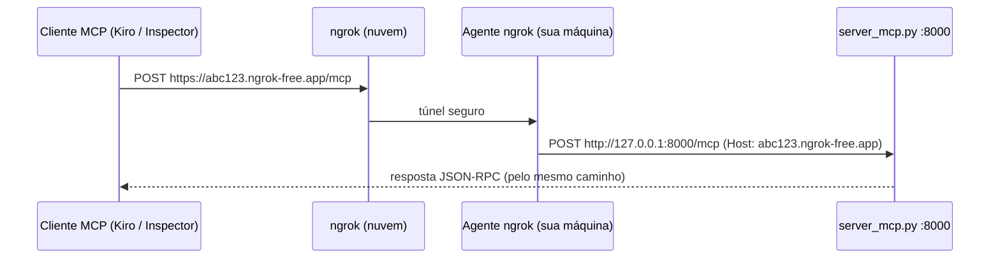

# Guia 2: Expondo o servidor MCP com ngrok

Este guia coloca o servidor que roda na sua máquina atrás de uma URL HTTPS pública, para que um cliente remoto (o Kiro ou o MCP Inspector em outra máquina) consiga usá-lo.

> ⚠️ **Somente para testes e estudo.** O endpoint não tem autenticação. Enquanto o túnel estiver aberto, qualquer pessoa com a URL pode chamar as tools e mexer no estoque e nos pedidos fictícios. Feche o túnel (`Ctrl+C`) ao terminar.

---

## Por que HTTP e não STDIO?

O STDIO funciona só entre processos na **mesma máquina**: o cliente inicia o servidor e conversa pelo stdin/stdout. O ngrok faz túnel de **tráfego de rede**, então o servidor precisa escutar numa porta HTTP. É para isso que existe o modo `--transport http` (Streamable HTTP, endpoint `/mcp`).



---

## 1. Instalar e autenticar o ngrok (uma vez só)

```bash
ngrok version                 # já instalado? (ex.: "ngrok version 3.24.0")
brew install ngrok            # se não estiver instalado
```

1. Crie uma conta gratuita em <https://dashboard.ngrok.com/signup>.
2. Copie o seu authtoken em **Getting Started → Your Authtoken**.
3. Registre o token na máquina:

```bash
ngrok config add-authtoken <SEU_TOKEN>
```

> O token fica salvo no arquivo de configuração do ngrok. Trate-o como uma senha: não o versione, não o compartilhe e evite exibi-lo em gravações ou compartilhamentos de tela.

---

## 2. Subir o túnel

Em um terminal:

```bash
ngrok http 8000
```

A saída mostra uma linha parecida com esta:

```
Forwarding   https://abc123.ngrok-free.app -> http://localhost:8000
```

Anote o host (`abc123.ngrok-free.app`): ele é o seu **host público**.

> 💡 **Domínio fixo:** contas gratuitas têm um *dev domain* estático, que aparece em **Domains** no dashboard ([anúncio do ngrok](https://ngrok.com/blog/free-static-domains-ngrok-users)). Com ele, a URL não muda entre uma sessão e outra, e você não precisa editar a configuração do Kiro toda vez:
>
> ```bash
> ngrok http 8000 --url https://<seu-dominio>.ngrok-free.app
> ```

---

## 3. Subir o servidor MCP liberando o host público

Em **outro** terminal, na pasta do projeto:

```bash
.venv/bin/python server_mcp.py --transport http --public-host abc123.ngrok-free.app
```

Ou pela variável de ambiente:

```bash
export PUBLIC_HOST=abc123.ngrok-free.app
.venv/bin/python server_mcp.py --transport http
```

Saída esperada:

```
WARNING vestuario_mcp: ATENÇÃO: endpoint HTTP SEM AUTENTICAÇÃO. ...
INFO vestuario_mcp: Endpoint local: http://127.0.0.1:8000/mcp
INFO vestuario_mcp: Host público liberado: https://abc123.ngrok-free.app/mcp
```

O `--public-host` também aceita a URL inteira (`https://abc123.ngrok-free.app/mcp`), porque o servidor extrai só o host.

### Por que o `--public-host` é obrigatório?

O SDK do MCP liga uma proteção contra **DNS rebinding**: só são aceitas requisições cujo header `Host` esteja numa allowlist. O padrão é `127.0.0.1:*`, `localhost:*` e `[::1]:*`. O ngrok repassa o host público (`Host: abc123.ngrok-free.app`), então, sem liberar esse host, toda chamada volta **`421 Invalid Host header`**.

### Verificando a proteção contra DNS rebinding

Para confirmar que a proteção está ativa por padrão:

1. Suba o servidor **sem** `--public-host` (`.venv/bin/python server_mcp.py --transport http`).
2. Rode o `curl` do passo 4. A resposta deve ser `421 Invalid Host header`.
3. Reinicie o servidor **com** `--public-host <host>` e rode o `curl` de novo. A resposta deve ser `200`.

---

## 4. Testar o endpoint público

```bash
curl -i -X POST https://abc123.ngrok-free.app/mcp \
  -H "Content-Type: application/json" \
  -H "Accept: application/json, text/event-stream" \
  -d '{"jsonrpc":"2.0","id":1,"method":"initialize","params":{"protocolVersion":"2025-06-18","capabilities":{},"clientInfo":{"name":"curl","version":"0"}}}'
```

| Resposta | Significado |
|---|---|
| `HTTP/2 200` com `serverInfo: "Vestuário MCP"` | Tudo certo |
| `421 Invalid Host header` | Faltou `--public-host`, ou o host está errado |
| `403 Invalid Origin header` | O header `Origin` não está liberado (a allowlist já inclui `https://<host>`) |
| `502`/`ERR_NGROK_8012` | O túnel está no ar, mas o servidor não está rodando na porta 8000 |
| `ERR_NGROK_3200` | O túnel caiu ou a URL mudou: rode `ngrok http 8000` de novo |

> A página de aviso do plano gratuito (*interstitial*) aparece só para navegadores pedindo HTML. Clientes MCP mandam `Accept: application/json, text/event-stream` e não são afetados.

---

## 5. Painel de inspeção do ngrok

Abra <http://127.0.0.1:4040> no navegador. Cada requisição que passa pelo túnel aparece com headers e corpo. Dá para acompanhar as mensagens JSON-RPC (`initialize`, `tools/list`, `tools/call`) que o cliente manda quando o Kiro usa uma tool. O botão **Replay** reenvia uma requisição.

---

## 6. Conectar os clientes

- **MCP Inspector:** Transport Type **Streamable HTTP**, URL `https://abc123.ngrok-free.app/mcp`.
- **Kiro:** entrada com `"url": "https://abc123.ngrok-free.app/mcp"` no `mcp.json`.

O passo a passo de cada um está no [Guia 3](03-conectando-clientes.md).

---

## 7. Encerrar

1. `Ctrl+C` no terminal do ngrok. A URL para de funcionar na hora.
2. `Ctrl+C` no terminal do servidor. O estado em memória (carrinhos e pedidos) é descartado.
3. Se tiver adicionado a entrada remota no Kiro, remova ou desabilite (`"disabled": true`).

---

## Checklist antes de expor o servidor

- [ ] `ngrok config add-authtoken` já feito na máquina
- [ ] Dev domain fixo anotado (ou plano para atualizar a URL no Kiro)
- [ ] Terminal 1: `ngrok http 8000 [--url ...]`
- [ ] Terminal 2: `.venv/bin/python server_mcp.py --transport http --public-host <host>`
- [ ] `curl` do passo 4 respondendo 200
- [ ] Túnel encerrado ao terminar
